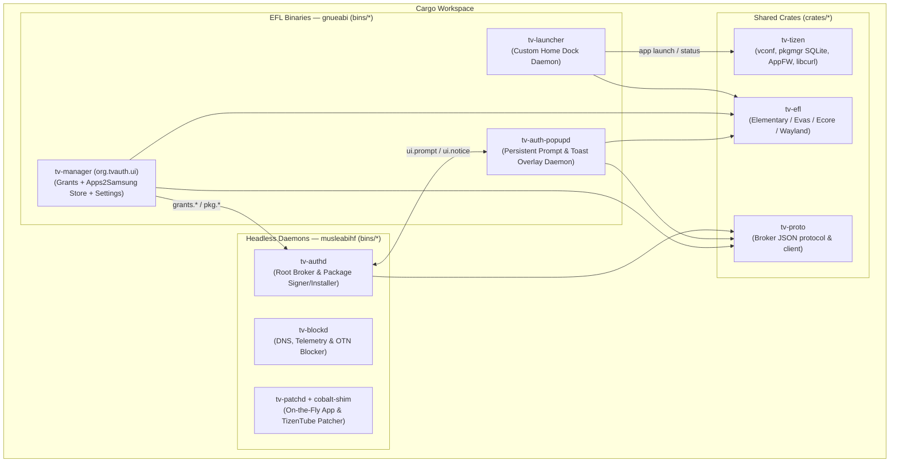
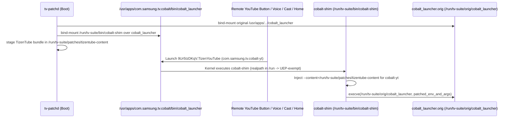

# Rust TV Suite & Workspace Architecture Plan

*Target platform: Samsung Tizen 6.5 TVs (ARMv7, PontusM / QN90B / S95B, firmware `T-PTMDEUC-1720.7`).*

## 1. Summary & Goals

This plan consolidates the next evolution of this repository: moving from a standalone `tv-authd` + `.NET Core 3.1` UI and the monolithic Node.js Vetro package (`vetrotvapp`) to a **single Cargo workspace** of small, focused, native Rust daemons and EFL UIs.

### Core Objectives

1. **Workspace & Shared Crates:** Reorganize the repository into a Cargo workspace sharing common crates for the broker wire protocol (`tv-proto`), EFL/Wayland UI rendering (`tv-efl`), and Tizen platform APIs (`tv-tizen`).
2. **Split `tv-authd` UI into a Popup Daemon + Management App:**
   - **`tv-auth-popupd`:** A persistent, lightweight (~30 KB) native Rust EFL overlay daemon that renders `ui.prompt` approval modals and `ui.notice` toasts in `<5 ms` without `app_launcher` cold starts, mode-guessing timers, or foreground focus stealing.
   - **`tv-manager` (`org.tvauth.ui`):** A user-launched native Rust EFL app (replacing the `.NET Core 3.1` TPK) for managing `tv-authd` grants, browsing/installing packages from **`Apps2Samsung`**, and toggling system debloat/patcher features.
3. **On-Device `Apps2Samsung` Store:** Browse the `Apps2Samsung/tizen-community-packages` marketplace directly on the TV and install/update/uninstall `.wgt` and `.tpk` packages on-device via `tv-authd` (using on-device `xmlsec1` re-signing with the TV's enrolled 10-year user CAs — no PC, SDB, Developer Mode, or Samsung Account required).
4. **Port Core Vetro Features to Focused Rust Daemons:**
   - **`tv-blockd`:** Tracking, ad, telemetry, and OTN firmware-update blocker (cross-namespace `/etc/hosts` bind-mounting, `vconf` OTN lock, systemd `ConditionPathExists=!` brake files, and bloatware package disabler).
   - **`tv-launcher`:** Custom EFL Home dock daemon that intercepts the remote Home button (`evdev` key `63`) and replaces Samsung's ad-heavy Smart Hub (`com.samsung.tv.csfs`).
   - **`tv-patchd`:** Declarative on-the-fly app patcher that bind-mounts runtime overlays/wrappers from `/run` before app launch — allowing stock YouTube (`9Ur5IzDKqV.TizenYouTube`) to run TizenTube in-place without needing a separate `TizenTubeStandalone` package or Vetro's icon/kill workarounds.

---

## 2. Platform Constraints & Build Targets

### 2.1 UEP (User Execution Prevention) Strategy

Per [`docs/samsung-tv-uep.md`](docs/samsung-tv-uep.md), the Tizen kernel's UEP hook intercepts `execve()` and blocks unsigned ELF binaries whose canonical `realpath()` resolves under `/opt/` or `/home/`. Binaries whose `realpath()` resolves under `/run/` (`tmpfs`) or `/usr/` (`squashfs`) are **exempt**.

- **Background Daemons (`tv-authd`, `tv-auth-popupd`, `tv-blockd`, `tv-patchd`, `tv-launcher`):** Installed persistently under `/opt/tv-suite/bin/` and copied to `/run/tv-suite/bin/` on boot before execution.
- **User-Launchable TPKs (`org.tvauth.ui` / `tv-manager`):** The TPK's `<ui-application exec="...">` entry points to a 2-line `/bin/sh` wrapper script inside `/opt/usr/apps/org.tvauth.ui/bin/`:
  ```sh
  #!/bin/sh
  exec /run/tv-suite/bin/tv-manager "$@"
  ```
  Because `/bin/sh` lives on the read-only rootfs (`/usr/bin/sh`) and the target ELF lives under `/run/`, UEP allows execution while Tizen's `amd` tracks the app lifecycle normally.

### 2.2 Two Rust Compilation Targets

| Target Triple | Linkage | Used For | Why |
|---|---|---|---|
| `armv7-unknown-linux-musleabihf` | Static (`musl`) | `tv-authd`, `tv-blockd`, `tv-patchd`, `cobalt-shim`, `tv-auth-cli` | Zero runtime shared-library dependencies; immune to firmware glibc/OpenSSL changes. |
| `armv7-unknown-linux-gnueabi` | Dynamic (`glibc >= 2.4`, soft-float ABI) | `tv-auth-popupd`, `tv-manager`, `tv-launcher` | Links against the TV's `/usr/lib/libelementary.so.1`, `libevas.so.1`, `libecore.so.1`, `libvconf.so.0`, `libcapi-appfw-*.so.0`, and `libcurl.so.4` via [`root-broker/sysroot`](root-broker/sysroot/README.md). |

All crates use **synchronous/blocking Rust only** (no `tokio` or `async` runtimes). Headless daemons use `std::net::UnixListener` / `poll` / threads, and EFL binaries integrate sockets, pipes, and `evdev` file descriptors directly into the EFL main loop via `ecore_main_fd_handler_add`.

---

## 3. System Architecture & Cargo Workspace Layout



### Proposed Repository Layout

```text
Cargo.toml                        # Workspace root
crates/
  tv-proto/                       # Shared wire protocol, framing, and sync client for /run/tv-auth/broker.sock
  tv-efl/                         # Safe Rust bindings for Elementary, Evas, Ecore, Wayland, and remote keygrabs
  tv-tizen/                       # Bindings for libvconf, libsqlite3 (pkgmgr/webappservice DBs), AppFW, libdlog, libcurl
bins/
  tv-authd/                       # Root broker daemon (migrated from root-broker/daemon)
  tv-auth-cli/                    # Diagnostic CLI client
  tv-auth-popupd/                 # Persistent EFL overlay daemon for prompts & toasts
  tv-manager/                     # User-launched EFL app (Grant Manager + Apps2Samsung Store + Suite Settings)
  tv-blockd/                      # DNS ad/tracking blocker, OTN update blocker & telemetry service disabler
  tv-patchd/                      # On-the-fly app patcher daemon + cobalt_launcher wrapper shim
  tv-launcher/                    # Custom EFL Home screen dock daemon
sysroot/                          # TV shared-library sysroot & fetch script (from root-broker/sysroot)
docs/                             # Architecture & reverse-engineering documentation
```

---

## 4. Shared Crates Design

### 4.1 `crates/tv-proto`
Extracted from [`root-broker/daemon/src/protocol.rs`](root-broker/daemon/src/protocol.rs):
- Request/response types for `exec`, `grants.list`, `grants.set`, `grants.revoke`, `grants.audit`, `pkg.list`, `pkg.install`, `pkg.uninstall`, and the UI channel (`ui.hello`, `ui.prompt`, `ui.decision`, `ui.notice`).
- Bounded newline-delimited JSON reader/writer (`MAX_LINE_BYTES`) and a synchronous `BrokerClient` helper used by `tv-auth-popupd`, `tv-manager`, `tv-launcher`, and `tv-auth-cli`.

### 4.2 `crates/tv-efl`
Evolved from [`root-broker/spikes/efl-popup/src/efl.rs`](root-broker/spikes/efl-popup/src/efl.rs) and [`root-broker/ui/dotnet/Interop.cs`](root-broker/ui/dotnet/Interop.cs):
- **Window & Wayland management:** `elm_win_add` (`ELM_WIN_NOTIFICATION` at layer `250` for overlays; `ELM_WIN_BASIC` for full-screen apps), `elm_win_alpha_set`, `elm_win_autodel_set`, `elm_win_raise`, `elm_win_activate`.
- **Dynamic Remote Keygrabbing:** Safe RAII guard around `elm_win_keygrab_set` / `elm_win_keygrab_unset` (`XF86Back`, `Cancel`, `Escape`, `Return`, `KP_Enter`, `Up`, `Down`, `Left`, `Right`, `XF86Home`, color buttons) with `OR_EXCLUSIVE` mode so background daemons only intercept keys while an interactive surface is visible.
- **Canvas & 9-Slice Card Primitives:** Raw Evas wrappers (`evas_object_rectangle_add`, `evas_object_text_add`, `evas_object_image_filled_add`, `evas_object_image_border_set` for rounded 9-slice card/button PNGs, `evas_object_clip_set` for scroll viewports).
- **Event Loop Integration:** Safe wrappers for `ecore_main_fd_handler_add` (attaching Unix sockets, worker pipes, and `/dev/input/event*` fds to the EFL loop), `ecore_timer_add`, and `ecore_animator_add` (smooth 60 Hz focus/scroll interpolation).

### 4.3 `crates/tv-tizen`
- **`vconf` wrapper (`libvconf.so.0`):** Read/write integer, bool, and string keys (`db/menu/support/softwareupdate/autoupdate`, `db/menu/smart_hub/ontvsetting/auto_start`, etc.) and subscribe to key changes.
- **Package DB reader (`libsqlite3.so.0`):** Read-only queries against `/opt/dbspace/.pkgmgr_parser.db` and `/opt/dbspace/.webappservice.db` to enumerate installed packages, versions, labels, icon paths, `app_type`, `nativeID`, and `native.userdata` without spawning `pkgcmd`.
- **App Launch & Control (`libcapi-appfw-app-control.so.0`, `libaul.so.0`):** Launch apps by `appid`, send `app_control` intents, query running PIDs, and terminate conflicting containers (`app_launcher -k` / `aul_terminate_pid`).
- **HTTP Client (`libcurl.so.4`):** Thin synchronous FFI wrapper around `/usr/lib/libcurl.so.4` (backed by the TV's OpenSSL 3 and CA bundle) for fetching JSON catalogs, app icons, `.wgt`/`.tpk` packages, and DNS blocklists without linking a second TLS stack into our binaries.

---

## 5. Component Specifications

### 5.1 `tv-authd` + `tv-auth-popupd` Split (Daemonized Popup UI)

#### Why Split?
Previously, `org.tvauth.ui` was a single TPK launched on-demand via `app_launcher -s org.tvauth.ui`, which required:
- Waiting 1–3 seconds for `amd` to cold-start the UI process before a prompt or toast could appear.
- A 750 ms startup delay heuristic to guess whether `tv-authd` launched it for a prompt or the user clicked its tile on the Home screen ([`root-broker/ui/README.md`](root-broker/ui/README.md#L10-L24)).
- Complex retry/cooldown state in [`approval.rs`](root-broker/daemon/src/approval.rs) (`MAX_PROMPT_UI_RETRIES`, `ui_launch_timeout`, `launch_cooldown`).
- Disrupting the foreground app's focus when showing a non-interactive `ui.notice` toast.

#### New Design
1. **`tv-auth-popupd` (`/run/tv-suite/bin/tv-auth-popupd`):**
   - Runs as its own dedicated systemd unit (`tv-auth-popupd.service`, `After=tv-authd.service`, `Requires=tv-authd.service`, `Restart=always`, with `HOME=/home/owner`, `XDG_RUNTIME_DIR=/run`, `WAYLAND_DISPLAY=wayland-0`, `ELM_ENGINE=wayland_egl`).
   - Connects to `/run/tv-auth/broker.sock` with `ui.hello` at startup and stays connected permanently (automatically reconnecting if `tv-authd` restarts).
   - **Idle state:** Window is hidden (`evas_object_hide`), **no remote keys are grabbed**, RSS is ~3–5 MB, CPU is 0%.
   - **Toast mode (`ui.notice`):** Renders the bottom-right notification card, shows the `NOTIFICATION_TOP` window **without grabbing any remote keys** (so the user's remote navigation in YouTube/Jellyfin is completely uninterrupted), and hides after the 4 s timer.
   - **Prompt mode (`ui.prompt`):** Renders the approval modal (`exec`, `install`, or `uninstall`), shows and raises the `NOTIFICATION_TOP` window, acquires exclusive keygrabs (`Left`, `Right`, `Up`, `Down`, `Return`, `XF86Back`, `Cancel`), sends `ui.decision` on button press or timeout, immediately releases all keygrabs, and hides the window.
2. **Fixing `.wgt` Installation in `tv-authd`:**
   - Currently ([`docs/tv-authd-pkg-install-plan.md`](docs/tv-authd-pkg-install-plan.md#L889-L893)), `.tpk` installation works end-to-end, while `.wgt` installation fails with `install failed[118004][-4:Operation not allowed:Load archive info fail]`.
   - Investigation on `tv-bureau.home` traced this string to `/usr/lib/libapp-installers.so.1.35.17` (`src/common/archive_info.cc`), which calls `WgtArchiveInfo::LoadArchiveInfo()` in `/usr/lib/libwgt-installer.so` and `VdWgtArchiveInfo::ExtractPackageArchive()` in `/usr/lib/libvd-wgt-installer.so` inside `/usr/bin/wgt-backend`.
   - Because `wascmd` talks over IPC to `webappservice` / `pkgmgr-server`, `/usr/bin/wgt-backend` is spawned in **PID 1's mount namespace** rather than `wascmd`'s `unshare -m` namespace. We will trace `dlogutil WGT_BACKEND VD_WGT_BACKEND APP_INSTALLERS` during a staged `.wgt` install and adjust [`wasinstall.rs`](root-broker/daemon/src/wasinstall.rs) / [`pkgsign.rs`](root-broker/daemon/src/pkgsign.rs) so `.wgt` archives install just like `.tpk` archives.

---

### 5.2 `tv-manager` (`org.tvauth.ui`) — Settings & On-Device `Apps2Samsung` Store

Because popups now live in `tv-auth-popupd`, `org.tvauth.ui` (`tv-manager`) becomes a clean, standard full-screen EFL app launched from the TV's app grid or `tv-launcher`.

It is organized into three tabs navigated with the remote's `Left`/`Right`/`Up`/`Down` keys:

1. **Apps2Samsung Store (`Store` tab):**
   - Fetches the community catalog JSON from `Apps2Samsung/tizen-community-packages` (plus user-configured repository feeds in `/opt/tv-suite/etc/repos.json`, including our own repo's releases).
   - Cross-references installed packages and versions via `tv-authd`'s `pkg.list` (and `/opt/dbspace/.pkgmgr_parser.db`).
   - Displays each app's icon (cached in `/run/tv-suite/cache/icons/`), title, category, installed vs. latest version, and action button: **Install**, **Update (`vX → vY`)**, **Launch**, or **Uninstall**.
   - Selecting **Install** or **Update** downloads the `.wgt`/`.tpk` to `/tmp/tv-store/<pkgid>.<ext>` on a background worker thread (streaming progress to the EFL loop via an `ecore` pipe) and calls `pkg.install` on `/run/tv-auth/broker.sock`.
   - `tv-authd` stages the archive, re-signs it on-device with `xmlsec1` and the TV's enrolled user CA, installs it via `wascmd`, and registers its tile on the Home screen.
2. **Permissions & Grants (`Permissions` tab):**
   - Port of the `.NET` Grant Manager screen ([`root-broker/ui/dotnet/Program.cs`](root-broker/ui/dotnet/Program.cs)): lists all known callers, toggles policies (`allow_always` / `prompt` / `deny`) and toast modes (`always` / `first` / `off`), revokes grants, and displays the recent `grants.audit` log.
3. **System & Tweaks (`Tweaks` tab):**
   - Live status and toggles for `tv-blockd` (DNS ad/tracking blocker, OTN firmware update blocker, telemetry service brakes, bloatware package disabler) and `tv-patchd` (TizenTube patch for stock YouTube).

---

### 5.3 `tv-blockd` — Tracking, Ad & OTN Firmware-Update Blocker

A static `musl` Rust daemon (`/run/tv-suite/bin/tv-blockd`) replacing Vetro's `local-dns.js`, `blocklist.js`, `quick-wins.js`, and `debloat-commands.js`. Configured via `/opt/tv-suite/etc/blockd.toml`.

1. **OTN Firmware Update Lock:**
   - Sets `vconf` key `db/menu/support/softwareupdate/autoupdate = 0` at boot and monitors/re-applies it if changed.
   - Always includes Samsung OTN update hosts (`otn.samsungcloudcdn.com`, `otnprd8.samsungcloudsolution.net`, `otnprd9.samsungcloudsolution.net`, `otnprd10.samsungcloudsolution.net`, `otnprd11.samsungcloudsolution.net`, `www.samsungotn.net`, `test.samsungotn.net`) in the blocked hosts set when OTN blocking is enabled.
2. **Cross-Namespace `/etc/hosts` Sinkhole:**
   - Compiles the built-in Samsung ACR / telemetry / ad host list + enabled remote blocklists (cached at `/opt/tv-suite/var/blocklist-cache.txt`) into `/run/tv-suite/hosts` (`0.0.0.0 <domain>`).
   - Bind-mounts `/run/tv-suite/hosts` over `/etc/hosts` in PID 1's mount namespace **and** iterates `/proc/[0-9]*/ns/mnt` (via `setns(fd, CLONE_NEWNS)`) to apply the bind mount inside every isolated service mount namespace (such as `webappservice` and `xwalk`).
   - Periodically reconciles newly spawned mount namespaces so containers started after boot also receive the `/etc/hosts` bind mount.
3. **Systemd Telemetry Brake Files & Process Killer:**
   - Creates `ConditionPathExists=!` brake files used by Samsung's systemd units:
     - `/opt/usr/share/systemd/system/canalysis-daemon`
     - `/opt/usr/share/systemd/system/pisa-service`
     - `/opt/usr/share/systemd/system/vision-data-recognition-service`
     - `/opt/usr/share/systemd/system/com.samsung.tv.airplay-service` & `com.samsung.tv.airplay-service-2` (optional toggle)
     - `/tmp/eltlaunch.cond` (`elt-daemon.service`)
     - `/opt/usr/home/owner/share/ime/disable_preloading`
   - Stops and masks active telemetry units (`canalysis.service`, `dlog_logger.service`, `ep-agent.service`, `faultmgr.service`, `smart_deadlock.service`, `trace_manager.service`) and kills `EdgeScraper`.
4. **Curated Bloatware Package Disabler:**
   - Disables/enables configured bloatware packages via `pkgcmd -D -t app -n <pkgid> --uid 5001` (and `-E` to re-enable), guarded by a hard-coded safety blocklist of critical system packages (`com.samsung.tv.csfs`, `com.samsung.tv.cobalt`, `org.tizen.chromium-efl`, `org.tvauth.*`, etc.).

---

### 5.4 `tv-patchd` — On-the-Fly App & TizenTube Patcher

#### How Stock YouTube + Cobalt + TizenTube Work on the TV
Inspection of `tv-living.home` and `tv-bureau.home` revealed the exact launch chain:
1. Official YouTube (`9Ur5IzDKqV.TizenYouTube`) is a hybrid WGT wrapper whose `/opt/share/packages/9Ur5IzDKqV.xml` declares:
   - `http://samsung.com/tv/metadata/launch.in.container = true`
   - `http://samsung.com/tv/metadata/MountPath = /usr/apps/com.samsung.tv.cobalt` (`pkgid="com.samsung.tv.cobalt"`)
   - `http://samsung.com/tv/metadata/nativeID = com.samsung.tv.cobalt-yt`
   - `http://samsung.com/tv/metadata/native.userdata = --base_url=https://www.youtube.com/tv --dial_name=YouTube --use_eden --start_frag=#start`
2. When `9Ur5IzDKqV` is launched, Tizen executes `/usr/apps/com.samsung.tv.cobalt/bin/cobalt_launcher`, which queries `libcapi-appfw-app-manager.so.0` for `nativeID="com.samsung.tv.cobalt-yt"`, reads `native.userdata`, and passes those flags into `libcobalt.so`.
3. `TizenTubeStandalone` (`xvvl3S1TT1`) works by registering a *second* package with the same `nativeID="com.samsung.tv.cobalt-yt"` and `native.userdata="... --content=/home/owner/share/tizentube-content ..."`. Vetro's "Fix TizenTube" only copied YouTube's icon onto the `xvvl3S1TT1` tile in Vetro's dock and ran `app_launcher -k com.samsung.tv.cobalt-yt` before launching `xvvl3S1TT1`.

#### How `tv-patchd` Does This Cleanly In-Place
Instead of requiring a separate `xvvl3S1TT1` app tile, `tv-patchd` patches official YouTube (`9Ur5IzDKqV`) on the fly:



1. **Bind-Mount Wrapper:**
   - `tv-patchd` bind-mounts the original `/usr/apps/com.samsung.tv.cobalt/bin/cobalt_launcher` to `/run/tv-suite/orig/cobalt_launcher`, and bind-mounts `/run/tv-suite/bin/cobalt-shim` over `/usr/apps/com.samsung.tv.cobalt/bin/cobalt_launcher`.
   - Because the kernel checks `realpath()` on the mounted file's backing dentry (`/run/tv-suite/bin/cobalt-shim`), UEP permits execution.
2. **Runtime Injection (`cobalt-shim` + Manifest Overlay):**
   - For `com.samsung.tv.cobalt-yt`, `tv-patchd` overlays `/opt/share/packages/9Ur5IzDKqV.xml` (via bind mount from `/run/tv-suite/patches/9Ur5IzDKqV.xml` + `pkgmgr-server` reload or `LD_PRELOAD` interception of `app_info_foreach_metadata` in `cobalt-shim`) to append `--content=/run/tv-suite/patches/tizentube-content` to `native.userdata`.
   - `cobalt-shim` also ensures any stale `cobalt` instance with a different `appid` is cleanly terminated before `execve`ing `/run/tv-suite/orig/cobalt_launcher`.
3. **Result:**
   - Pressing the **physical YouTube button** on the Samsung remote, casting from a phone via DIAL, launching from Samsung Home, or launching from `tv-launcher` all open official YouTube (`9Ur5IzDKqV`) with TizenTube injected.
   - Disabling the patch in `tv-manager` simply unmounts the bind mounts, immediately restoring 100% stock YouTube without touching flash storage.
4. **General Patch Rules (`/opt/tv-suite/etc/patches.d/*.toml`):**
   - Any other app (WGT or native) can be patched declaratively via file/directory bind mounts from `/run/tv-suite/patches/<pkgid>/` over `/opt/usr/apps/<pkgid>/` or `/opt/usr/home/owner/apps_rw/<pkgid>/`.

---

### 5.5 `tv-launcher` — Custom EFL Home Dock Daemon

A native Rust EFL daemon (`/run/tv-suite/bin/tv-launcher`) replacing Vetro's `dock.js` + `tvlauncher-dotnet.dll`:

1. **Lifecycle & Standby Survival:**
   - Runs as a systemd unit (`tv-launcher.service`) outside `sdbd`'s cgroup with `HOME=/home/owner`, `XDG_RUNTIME_DIR=/run`, `WAYLAND_DISPLAY=wayland-0`, `ELM_ENGINE=wayland_egl`.
2. **Home Key Interception Without Breaking Boot:**
   - Leaves `com.samsung.tv.csfs` enabled (disabling `csfs` breaks cold boot on several Tizen firmwares) and sets `vconf` `db/menu/smart_hub/ontvsetting/auto_start = 0`.
   - Opens `/dev/input/event*` non-blocking and attaches them to the EFL loop via `ecore_main_fd_handler_add`.
   - When the remote Home button (`EV_KEY`, `code == 63`, `value == 1`) is pressed:
     1. Immediately shows and raises the `tv-launcher` `NOTIFICATION_TOP` window and grabs navigation keys (`Left`, `Right`, `Up`, `Down`, `Return`, `XF86Back`).
     2. Asynchronously terminates `com.samsung.tv.csfs`, `com.samsung.tv.home.sidebar`, and `com.samsung.tv.home.media` if stock Smart Hub tried to wake up.
3. **UI & App Catalog:**
   - Renders a fast, 60 fps horizontal dock + "All Apps" drawer using `tv-efl` Evas primitives (9-slice rounded cards, app icon images, smooth `ecore_animator_add` focus ring).
   - Queries `/opt/dbspace/.pkgmgr_parser.db` and `/opt/dbspace/.webappservice.db` via `tv-tizen` to discover all user and system apps, icons, and `nativeID`s.
   - Includes a built-in shortcut tile to open **`tv-manager` (`org.tvauth.ui`)** for the `Apps2Samsung` store, permissions, and blocker/patcher settings.

---

## 6. Phased Implementation Roadmap

| Phase | Deliverable | Key Tasks |
|---|---|---|
| **Phase 1** | **Cargo Workspace & Shared Crates** | Create root `Cargo.toml` workspace; extract `crates/tv-proto` from `root-broker/daemon`; promote `spikes/efl-popup` into `crates/tv-efl`; create `crates/tv-tizen` (`vconf`, SQLite pkgmgr reader, `app_control`, `libcurl`). |
| **Phase 2** | **`tv-auth-popupd` Split & `.wgt` Install Fix** | Build `bins/tv-auth-popupd` (persistent EFL prompt + toast overlay daemon managed via its own `tv-auth-popupd.service` systemd unit); simplify `approval.rs` to use the persistent popup channel; diagnose and fix `.wgt` `Load archive info fail` in `tv-authd` (`wasinstall.rs`). |
| **Phase 3** | **`tv-manager` (`org.tvauth.ui`) & `Apps2Samsung` Store** | Build `bins/tv-manager` in Rust + `tv-efl` replacing the `.NET` TPK; implement the **Permissions** tab (grants & audit log) and the **Store** tab (fetches `Apps2Samsung/tizen-community-packages`, shows installed/update state, downloads and installs `.wgt`/`.tpk` via `tv-authd`). |
| **Phase 4** | **`tv-blockd` (DNS / Telemetry / OTN Blocker)** | Build `bins/tv-blockd` (`musl` static binary); implement OTN `vconf` lock, cross-namespace `/etc/hosts` bind-mounter (`/proc/*/ns/mnt`), systemd `ConditionPathExists=!` brake files, and bloatware disabler; wire toggles into `tv-manager`. |
| **Phase 5** | **`tv-patchd` (On-the-Fly Patcher & TizenTube)** | Build `bins/tv-patchd` and `cobalt-shim`; implement `/run` bind-mount wrapper for `cobalt_launcher` + `--content` injection for official YouTube (`9Ur5IzDKqV`); add toggle and TizenTube bundle updater in `tv-manager`. |
| **Phase 6** | **`tv-launcher` (Custom EFL Home Dock)** | Build `bins/tv-launcher` using `tv-efl` and `tv-tizen`; implement `/dev/input/event*` Home button interception (`code 63`), `csfs` suppression, animated app dock, and pin/reorder configuration. |

---

## 7. Implementation Status

### Phase 1 — done (2026-11-09)

The plan above was written against commit `7b39883` (managed `.NET` UI). By the
time Phase 1 started, `main` already shipped the native Rust/EFL `org.tvauth.ui`
with the validated `/run` bind-mount alias (`bins/tv-authd/src/ui_alias.rs`),
so §2.1's `/bin/sh` wrapper is not needed for it. Paths in §3–§5 that name
`root-broker/daemon`, `root-broker/ui`, or `spikes/efl-popup` now map to:

| Plan | Implemented |
|---|---|
| root `Cargo.toml` workspace | `Cargo.toml` (members `crates/*`, `bins/*`; `root-broker/` spikes excluded); one `Cargo.lock`; `cross-build.sh musl\|gnueabi` replaces the per-crate Docker invocations |
| `crates/tv-proto` | the former `daemon/src/protocol.rs` (requests, responses, `ui.*` messages, bounded framing), plus `NotifyMode`, label helpers, `ExecutionOutcome`, the client-side `ui` views (former UI `model.rs`), and a one-shot `call()` client. A test checks that daemon-serialized prompts/notices/grants parse as the client views. |
| `crates/tv-efl` | the native UI's `efl.rs` FFI surface (the evolved form of `spikes/efl-popup`) |
| `crates/tv-tizen` | `vconf` get/set (int/bool/str), read-only pkgmgr DB via `libsqlite3`, `app_control` launch + `aul_app_is_running`, `libcurl` GET; `examples/probe.rs` exercises each on the TV |
| `bins/tv-authd` | moved from `root-broker/daemon`; `protocol.rs` re-exports `tv-proto` |
| `bins/tv-auth-cli` | moved from `daemon/test-clients/rootcli`; builds requests with `serde_json`, sends them with `tv_proto::call` |
| `bins/tv-auth-ui` | moved from `root-broker/ui/rust` (split into popupd + manager in Phases 2–3); reads broker messages with the bounded `tv_proto::read_message` |
| `sysroot/` | moved from `root-broker/sysroot`; adds `libvconf`, `libsqlite3`, `libcapi-appfw-app-control`, `libaul`, `libcurl` |

Validation (host: `cargo fmt --check`, `cargo clippy --workspace --all-targets
-D warnings`, 116 daemon + 18 `tv-proto` + 1 CLI + 8 UI tests; the 133
pre-existing tests all carried over). On `tv-living` (2026-11-09), the
workspace `tv-authd` (`33ef31ee…`, 873,740 bytes) replaced the live daemon,
logged `ui_alias=mounted`, served `pkg.list` to the new `tvauth-cli`, and kept
serving Vetro's granted `exec`s. The rebuilt `org.tvauth.ui` installed through
the root role (`re_signed=true`, `backend=was`), mapped the `/run` alias with
`User::Pkg::org.tvauth.ui`, attached, and rendered the install toast; the
`tv-tizen` probe then launched its manager from root via `app_control`. The probe
also read `vconf` int/bool/string keys, listed 384 packages from the pkgmgr DB,
reported `aul_app_is_running` correctly, and fetched HTTPS from GitHub through the
TV's libcurl/CA store. Not exercised on the TV: the `vconf` setters.

Deferred until a phase needs them: the `tv-efl` safe wrappers (keygrab RAII,
`ecore_main_fd_handler_add`, animator, 9-slice images) for Phases 2/6; `vconf`
change subscriptions and the `.webappservice.db` reader for Phases 4/6; streamed
downloads with progress for Phase 3. Note for Phase 4: `tv-tizen` links
glibc libraries, so a static-musl `tv-blockd` cannot use it and would need the
gnueabi target or `vconftool`.

### Phase 2 — done (2026-11-09)

| Plan | Implemented |
|---|---|
| `tv-auth-popupd` systemd daemon | `bins/tv-auth-popupd` + `systemd/tv-auth-popupd.service`: uid 5001 with `SmackProcessLabel=User::Pkg::org.tvauth.ui` (no AUL; `elm_init`/`elm_run`), `/opt/tv-auth` mapped at `/run/opt/tv-auth` for UEP like `tv-authd`. Hidden and key-free when idle; `Ecore_Pipe` wake-ups, timer only while visible. Prompts at TOP with BACK grabbed only during the prompt; toasts never grab. ~469 KB binary (std + serde_json; the plan's ~30 KB was optimistic), 7–14 MB RSS. |
| simplify `approval.rs` | the `app_launcher` spawn, `LaunchState`, launch retries/cooldown, and the notice-only `launch` hello flag are gone. A queued prompt waits `--ui-attach-timeout-ms` (10 s) for a popup, then fails `ui_unavailable`; notices queue until a popup attaches; disconnect re-prompts are kept. CLI flags `--app-launcher`, `--ui-app-id`, `--ui-launch-timeout-ms`, `--launch-cooldown-ms`, `--max-launch-attempts` were removed. |
| `org.tvauth.ui` as manager | now manager-only and sends no `ui.hello`; the daemon serves `grants.*` to the UI identity without registration. Full Store/Tweaks UI is Phase 3. |
| shared code | the UI's broker client moved to `tv_proto::client` (optional hello, injectable log and wake hooks) and its markup helpers to `tv_proto::markup`; widgets, log, `elm_init`/`elm_run`, `Ecore_Pipe` FFI to `tv-efl`. `tv-efl/examples/overlay-probe.rs` checks the standalone-overlay path on the TV. |
| `.wgt` `Load archive info fail` | did not reproduce: minimal WGTs install through the existing WAS path, appear in Home, launch, and uninstall, and plain `pkgcmd` gets past archive loading. No daemon change was needed; see the 2026-11-09 update in `docs/tv-authd-pkg-install-plan.md`. |

Validated on tv-living (2026-11-09): the popup registered with the old and the
new daemon (re-attaching within 2 s of a daemon restart); toasts for a Vetro
first-use exec and a root install; prompts from a package identity
(`tvauth-cli exec id` under `systemd-run`) appeared within ~1 s and were
decided by timeout (`prompt_timeout`), injected BACK (`user_denied`), and
injected Right + Return (Allow once, `id` ran as root); idle CPU stayed at 0.
Not exercised: **Always allow** from the popup, a popup crash during a prompt,
and a cold boot with the new unit.

### Phase 3 — done (2026-11-09)

| Plan | Implemented |
|---|---|
| `tv-manager` (`org.tvauth.ui`) | `bins/tv-auth-ui` (package and binary names kept: the daemon's UEP alias and protections key on them) is now the suite manager with **Store** and **Permissions** tabs. The **Tweaks** tab waits for Phases 4–5. |
| Apps2Samsung store | reads the official signed index `resolved.json.signed` (not the `packages/*.json` sources): TLS via the TV's libcurl, RSA-SHA256 against the pinned Apps2Samsung key via the TV's libcrypto (`tv_tizen::crypto`), 7-day freshness, per-file SHA-256 before install. 234 installable apps today. User-configured repository feeds (`repos.json`) are not implemented. |
| install via `tv-authd` | the UI identity may now send `pkg.install`/`pkg.uninstall`/`pkg.list`, handled exactly like an ordinary package's (staging, policy, prompt); its own package stays protected. UI connection allowance raised from 2 to 6. |
| grants + audit | `grants.audit` (UI only) returns recent decision/package lines from the daemon log; the Permissions tab shows them. |
| icons | fetched per visible page, hash-checked, cached in `/tmp/tv-store/icons` (the plan's `/run/tv-suite/cache` is root-owned). |

Validated on tv-living: catalog verify + listing, an install (prompt →
re-sign → WAS → Home row) and a removal of `DvNullSh01` from the store, and
the Permissions tab, all through injected remote keys and checked with
`enlightenment_info -dump_screen`.

Found while validating: **the Phase 2 popup never gets the TOP notification
layer**. efl_util accepts the request, but the compositor places the
systemd-started popup's prompt in `E_LAYER_CLIENT_ABOVE` (toast in
`NOTIFICATION_LOW`), so notification-layer windows can cover it. The manager
works around this by hiding itself during a change. Fixing it (e20's level
policy for non-AUL clients) is open, and until then the consent prompt is
less robust against overlays than the pre-Phase-2 AUL-launched UI.

Not done: progress percentages for downloads (a status line only), the
`pkgid` renaming the Apps2Samsung TV-Store applies to colliding community
package ids, user-added repositories, and human-friendly wording for audit
lines.
